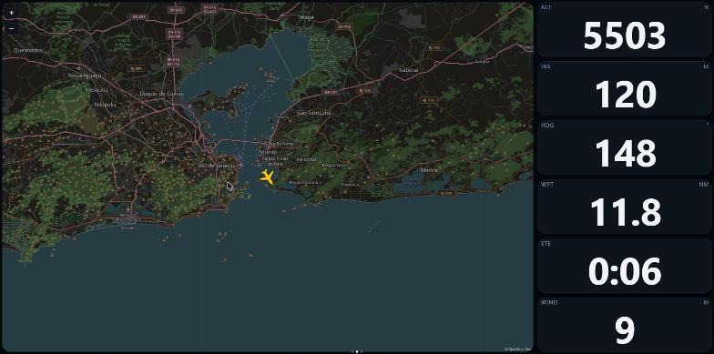
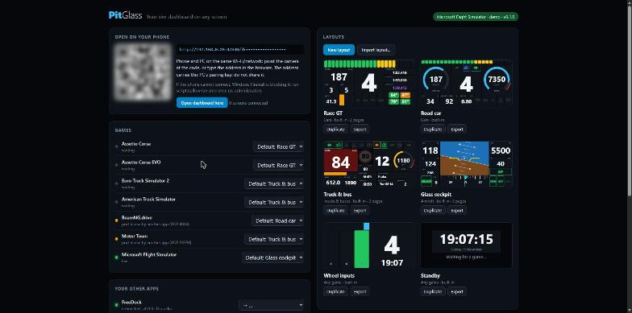
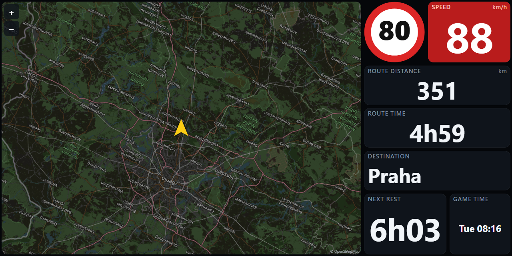
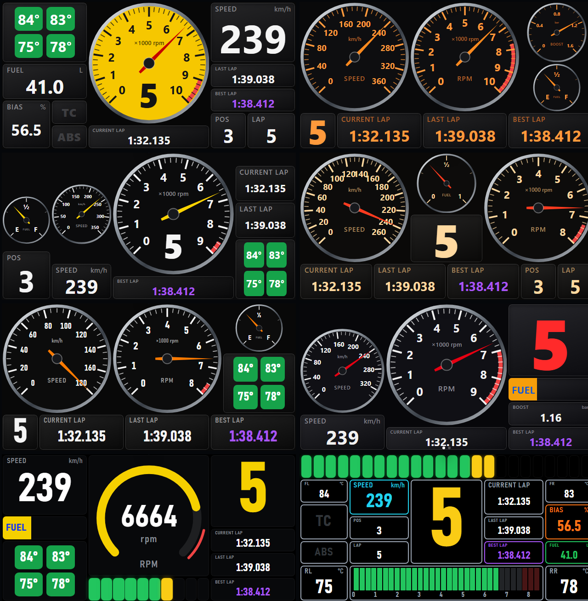
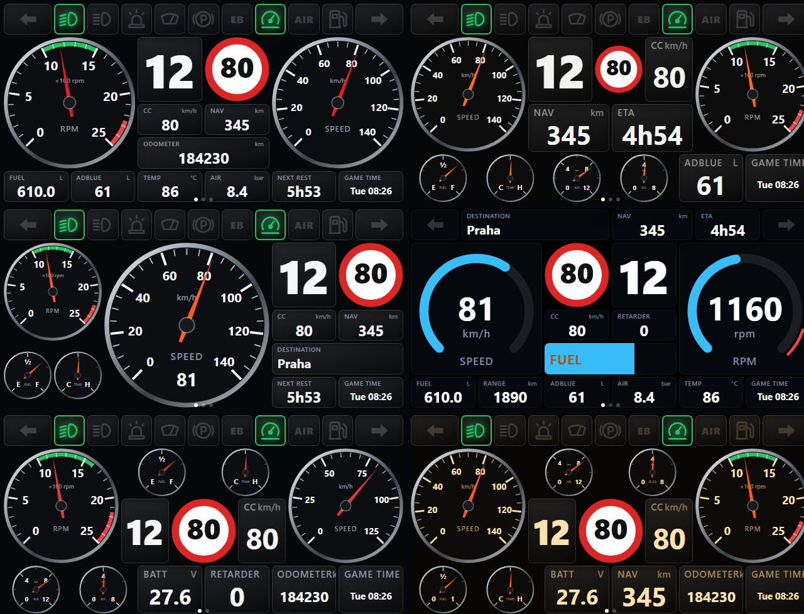

# PitGlass

**Turn any phone or tablet into a live dashboard for your simulator.** PitGlass runs on your gaming PC, reads the telemetry of the game you are playing and serves a dashboard page to any screen on your local network. Put an old phone on top of your wheel or next to your yoke: gear, shift lights, lap times, truck job, artificial horizon, moving map.

No app to install on the phone, no account, no cloud. It is a web page hosted by your own PC.

🇧🇷 [Leia em português](README.pt-BR.md)


| Trucks and buses | Glass cockpit |
| --- | --- |
|  |  |
| **Moving map** | **Autopilot panel (touch)** |
|  |  |

## What it does

- **One dashboard, many games.** The layout changes by itself when you open another game.
- **Fully customizable.** A visual editor in the browser: drag widgets on a grid, resize, pick what each one shows, change colors, add pages. Layouts are plain JSON files you can share.
- **20 widgets**: numbers, segment displays, gear, shift lights, bar tachometer, bars, gauges and analog dials, indicator lights, text, clock, tyre temperatures, speed limit sign, artificial horizon, altimeter, heading rose and tape, moving map, track map and touch buttons.
- **Maps on a second screen.** Put a tablet next to the phone: the track with your position in Assetto Corsa, a GPS for the truck in ETS2/ATS, a moving map for the aircraft in Flight Simulator.
- **Touch buttons** that act on the sim (autopilot, lights, gear and flaps in Flight Simulator) and on companion apps.
- **English and Brazilian Portuguese**, metric or imperial units.
- **Made for old phones**: the page is small, has no framework, and only redraws what changed.
- **Demo mode**: fake telemetry for a race car, a truck or an aircraft, to build layouts without a game running.

## Games

| Game | How PitGlass reads it | What you need to do |
| --- | --- | --- |
| Assetto Corsa | the game's shared memory | nothing |
| Assetto Corsa EVO | the game's shared memory (laps and position are not published by the game yet) | nothing |
| Euro Truck Simulator 2 / American Truck Simulator | [scs-sdk-plugin](https://github.com/RenCloud/scs-sdk-plugin) shared memory | copy `scs-telemetry.dll` to `<game>\bin\win_x64\plugins` |
| BeamNG.drive | OutGauge, UDP 4444 (shared with FreeDock) | Options › Other › Protocols › enable OutGauge, 127.0.0.1, port 4444 |
| Motor Town: Behind the Wheel | the game's telemetry output, UDP 33330 | Options › Gameplay › Telemetry Data Output, 127.0.0.1:33330 |
| Microsoft Flight Simulator 2020 / 2024 | SimConnect | have a `SimConnect.dll` on the PC (MSFS SDK, or the Logitech flight panel plugin, which ships one) |

> **Status: 0.3, early.** Driven for real with Assetto Corsa and Euro Truck Simulator 2. The other game readers are ports of decoders that already run on real hardware in [FreeDock](https://github.com/agentkyo/freedock) and are covered by unit tests, but have not been driven inside PitGlass yet; the same goes for the maps. If a value looks wrong in your game, please open an issue.

## Quick start (Windows)

You need [Node.js 24 or newer](https://nodejs.org).

```
git clone https://github.com/agentkyo/pitglass
cd pitglass
PitGlass.cmd
```

`PitGlass.cmd` installs the dependencies on the first run, builds the page and `PitGlass.exe`, and starts it. PitGlass then lives in the **system tray** (the icons next to the clock) and opens the control panel at `http://localhost:47830`. Right-click the tray icon to open the control panel, restart, **start with Windows**, put a shortcut on the desktop, or quit. From then on, start it from the Start menu or by double-clicking `PitGlass.exe`.

`PitGlass.exe` is a small launcher compiled on your PC from [`tray/PitGlassTray.cs`](tray/PitGlassTray.cs) with the C# compiler that ships with Windows. To run in a console window instead, use `PitGlass.cmd console`.



**On the phone**: connect it to the same Wi-Fi/network as the PC and scan the QR code shown in the control panel.

If the phone cannot connect, Windows Firewall is blocking the port. Run `scripts\allow-lan.cmd` once: it asks for administrator rights and opens TCP 47830 **for your local network only**.

Without the launcher:

```
npm install
npm start            # build + run
npm run demo         # build + run with a fake race car
```

### Tips for the phone

- Tap the dashboard to show the toolbar: full screen, layout picker.
- Swipe left/right to change page.
- **Keep the screen on.** Browsers only let a page hold the screen awake on `https` or `localhost`. Two ways around it: turn on *Developer options › Stay awake* (screen stays on while charging), or use USB (below).
- **USB instead of Wi-Fi (Android):** enable USB debugging, run `adb reverse tcp:47830 tcp:47830` on the PC and open `http://localhost:47830/#/dash` on the phone. Lower latency, no Wi-Fi needed, and the page can keep the screen on by itself.
- Add the page to the home screen to open it like an app.

## Layouts

Thirty-seven layouts come with PitGlass. Pick one per game in the control panel, or from the toolbar on the phone.


| For | Layouts |
| --- | --- |
| Cars | **Race GT** · **Road car** · **Formula** (wheel display with shift LEDs) · **Turbo-era formula** (one big tachometer and four small dials) · **Pro datalogger** (aftermarket ECU dash, with a launch page) · **Classic '60s** (cream dials, chrome rings) · **Digital '84** (segment displays) · **Rally** · **Street tuner** · **Night stint** (red on black) |
| Trucks and buses | **Truck & bus** · **Classic truck** (analog) · **Digital cluster** · **Coach** |
| Aircraft | **Glass cockpit** · **Steam gauges** (the six-pack) · **Airliner** (flight display beside the map) · **Warbird** |
| After real cars | **Italia V8** (Ferrari 458 Italia: yellow tachometer between two displays) · **Twin-turbo '87** (Ferrari F40) · **Five dials** (Porsche 911 GT3) · **Touring car '87** (BMW M3 E30) · **Hachi-roku** (Toyota AE86) · **Multi-function** (Nissan GT-R R35, with its data screen) · **V10 screen** (Lamborghini Huracán) · **GT3 display** (race car data displays) |
| After real trucks and coaches | **Swedish twin-dial** (Scania R/S) · **German twin-dial** (Mercedes-Benz Actros) · **Big speedometer** (Volvo FH) · **Screen cockpit** (the all-screen generation) · **Grand tourer coach** (MAN Lion's Coach) · **Rodoviário** (Brazilian coaches on Mercedes-Benz O 500 chassis) |
| Maps, for a second screen | **Track map** (the circuit and where you are on it) · **Truck GPS** (the truck on the real map, turning with the road, with route distance and time) · **Moving map** (the aircraft on the real map) |
| Any game | **Wheel inputs** · **Standby** |

| Truck GPS (ETS2 / ATS) | Moving map (Flight Simulator) |
| --- | --- |
|  |  |

The layouts after real vehicles follow the arrangement, scales and colors of each instrument cluster, drawn with PitGlass widgets. They are impressions, not copies, and PitGlass is not affiliated with any of those makers.

| After real cars | After real trucks and coaches |
| --- | --- |
|  |  |

Every screen keeps its own choice: scan the QR code on a tablet too, tap the screen and pick a map there while the phone stays on the dashboard. More in [docs/LAYOUTS.md](docs/LAYOUTS.md#maps-and-a-second-screen).

### Make your own

Press **New layout** in the control panel, give it a name, and start from an empty grid (with one of the ready-made looks) or from a copy of any layout. In the editor:

- click a widget in the list to add it; it lands in the first free spot. Drag to move, pull the corner to resize;
- pick what it shows, its scale, labels and icon on the right;
- give any widget **its own colors** (panel, text, labels, accent) over the layout's, or remove its panel to lay it over another one, like the gear inside a tachometer;
- change the layout's colors, typeface and panel style on the left, and add pages;
- **Ctrl+Z / Ctrl+Y** undo and redo, **Ctrl+S** saves, arrows nudge, Delete removes.

The built-in layouts are read-only: **Duplicate** one and the copy is yours to change.


- Layouts live in `%APPDATA%\PitGlass\layouts` as JSON. **Export** and **Import** are in the control panel.
- The format, every widget and every channel are documented in [docs/LAYOUTS.md](docs/LAYOUTS.md).
- Made a good one? Send it to the [`layouts/`](layouts) folder with a pull request.

## Works with

PitGlass talks to these companion apps when they are running. All of it is optional.

| App | What PitGlass does with it |
| --- | --- |
| [FreeDock](https://github.com/agentkyo/freedock) (MiraBox N4 stream deck) | shows the deck's current page; dashboard buttons can change the deck page |
| [Ambibox LED](https://github.com/agentkyo/ambibox-led-ambilight) (USB ambilight strip) | flashes the strip purple on a new best lap; dashboard buttons can flash it or toggle game effects |
| IAmPcGamer | shows the detected game; dashboard buttons can take a screenshot or toggle the overlay |
| MyWheel | shows the connected wheel; accepts its live steering/pedals/gear feed, so input widgets work even in games without telemetry |

It also has a small local API for your own tools: `GET /api/telemetry` returns the current values as JSON, and `ws://localhost:47830/ws` streams them. See [docs/INTEGRATIONS.md](docs/INTEGRATIONS.md).

## Privacy and security

- Nothing leaves your network. The only outside request is the moving map, which loads tiles from OpenStreetMap on the phone.
- The server listens on your local network. A screen outside the PC must present the **pairing key** carried by the QR code; without it every request is refused. Treat the address like a password.
- Requests from other web sites are refused (Host and Origin are checked), so a page open in your browser cannot drive PitGlass.
- A paired phone can view dashboards and press dashboard buttons. Editing layouts and settings is only possible on the PC itself.
- Dashboard buttons can only trigger the actions on a fixed list (a set of Flight Simulator events and the companion app actions above). There is no "run a command" or "press a key".

## Roadmap

- Installer for Windows that does not need Node.js.
- Other cars on the track map.
- More games: Assetto Corsa Competizione, iRacing, rFactor 2 / Le Mans Ultimate, Forza (data out), X-Plane, DCS.
- Delta to best lap, fuel-per-lap calculator.
- Linux support for the UDP games.

## Development

```
npm run typecheck
npm test
npm run build
```

The server is TypeScript run directly by Node (no build step). The page in `web/` is bundled with esbuild into `dist/web`. To add a game, write a `Source` in `src/server/sources` that returns a frame of [channels](src/shared/channels.ts); every layout then works with it.

## License

[MIT](LICENSE). Map data © [OpenStreetMap](https://www.openstreetmap.org/copyright) contributors.

PitGlass is not affiliated with any game publisher or vehicle maker. Game, brand and model names are trademarks of their owners and are used only to say what a layout was modelled on.
