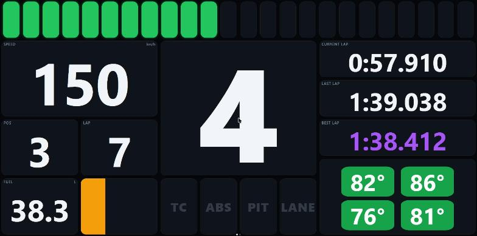
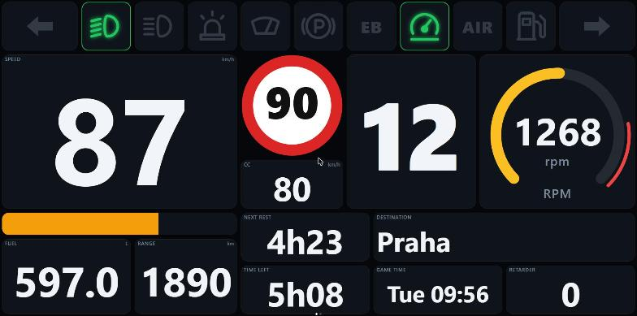
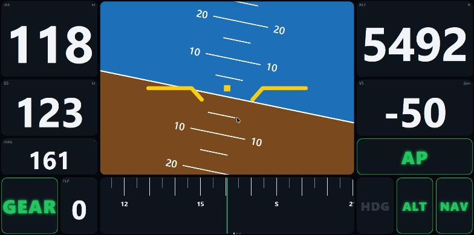
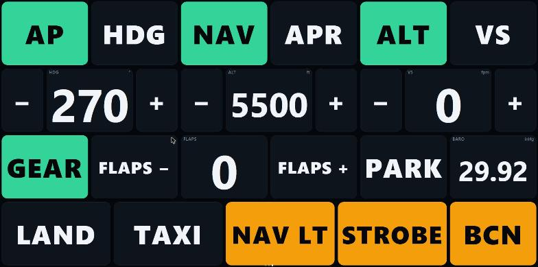
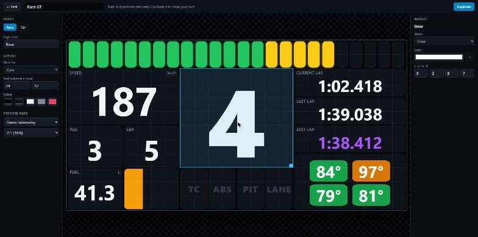

# PitGlass

**Turn any phone or tablet into a live dashboard for your simulator.** PitGlass runs on your gaming PC, reads the telemetry of the game you are playing and serves a dashboard page to any screen on your local network. Put an old phone on top of your wheel or next to your yoke: gear, shift lights, lap times, truck job, artificial horizon, moving map.

No app to install on the phone, no account, no cloud. It is a web page hosted by your own PC.

🇧🇷 [Leia em português](README.pt-BR.md)



| Trucks and buses | Glass cockpit |
| --- | --- |
|  |  |
| **Moving map** | **Autopilot panel (touch)** |
|  |  |

## What it does

- **One dashboard, many games.** The layout changes by itself when you open another game.
- **Fully customizable.** A visual editor in the browser: drag widgets on a grid, resize, pick what each one shows, change colors, add pages. Layouts are plain JSON files you can share.
- **14 widgets**: number, gear, shift lights, bar, gauge, indicator light, text, clock, tyre temperatures, speed limit sign, artificial horizon, heading tape, moving map and touch button.
- **Touch buttons** that act on the sim (autopilot, lights, gear and flaps in Flight Simulator) and on companion apps.
- **English and Brazilian Portuguese**, metric or imperial units.
- **Made for old phones**: the page is small, has no framework, and only redraws what changed.
- **Demo mode**: fake telemetry for a race car, a truck or an aircraft, to build layouts without a game running.

## Games

| Game | How PitGlass reads it | What you need to do |
| --- | --- | --- |
| Assetto Corsa | the game's shared memory | nothing |
| Assetto Corsa EVO | the game's shared memory (laps and position are not published by the game yet) | nothing |
| Euro Truck Simulator 2 / American Truck Simulator | [scs-sdk-plugin](https://github.com/RenCloud/scs-sdk-plugin) shared memory | copy `scs-telemetry.dll` to `<game>\bin\win_x64\plugins` |
| BeamNG.drive | OutGauge, UDP 4444 | Options › Other › Protocols › enable OutGauge, 127.0.0.1, port 4444 |
| Motor Town: Behind the Wheel | the game's telemetry output, UDP 33330 | Options › Gameplay › Telemetry Data Output, 127.0.0.1:33330 |
| Microsoft Flight Simulator 2020 / 2024 | SimConnect | have a `SimConnect.dll` on the PC (MSFS SDK, or the Logitech flight panel plugin, which ships one) |

> **Status: 0.1, early.** The dashboard, the editor and the server are tested with the demo telemetry. The game readers are ports of decoders that already run on real hardware in [FreeDock](https://github.com/agentkyo/freedock) and are covered by unit tests, but PitGlass itself has not been driven yet with every game above. If a value looks wrong in your game, please open an issue.

## Quick start (Windows)

You need [Node.js 24 or newer](https://nodejs.org).

```
git clone https://github.com/agentkyo/pitglass
cd pitglass
PitGlass.cmd
```

`PitGlass.cmd` installs the dependencies on the first run, builds the page, starts the server and opens the control panel at `http://localhost:47830`.


**On the phone**: connect it to the same Wi-Fi/network as the PC and scan the QR code shown in the control panel.

If the phone cannot connect, Windows Firewall is blocking the port. Run `scripts\allow-lan.cmd` once: it asks for administrator rights and opens TCP 47830 **for your local network only**.

Without the launcher:

```
npm install
npm start            # build + run
npm run demo         # build + run with a fake race car
```

### Tips for the phone

- Tap the dashboard to show the toolbar: full screen, layout picker.
- Swipe left/right to change page.
- **Keep the screen on.** Browsers only let a page hold the screen awake on `https` or `localhost`. Two ways around it: turn on *Developer options › Stay awake* (screen stays on while charging), or use USB (below).
- **USB instead of Wi-Fi (Android):** enable USB debugging, run `adb reverse tcp:47830 tcp:47830` on the PC and open `http://localhost:47830/#/dash` on the phone. Lower latency, no Wi-Fi needed, and the page can keep the screen on by itself.
- Add the page to the home screen to open it like an app.

## Layouts

Open the control panel, pick a layout and press **Duplicate**: the built-in ones are read-only, your copy is yours to change.



- Layouts live in `%APPDATA%\PitGlass\layouts` as JSON. **Export** and **Import** are in the control panel.
- The format, every widget and every channel are documented in [docs/LAYOUTS.md](docs/LAYOUTS.md).
- Made a good one? Send it to the [`layouts/`](layouts) folder with a pull request.

## Works with

PitGlass talks to these companion apps when they are running. All of it is optional.

| App | What PitGlass does with it |
| --- | --- |
| [FreeDock](https://github.com/agentkyo/freedock) (MiraBox N4 stream deck) | shows the deck's current page; dashboard buttons can change the deck page |
| [Ambibox LED](https://github.com/agentkyo/ambibox-led-ambilight) (USB ambilight strip) | flashes the strip purple on a new best lap; dashboard buttons can flash it or toggle game effects |
| IAmPcGamer | shows the detected game; dashboard buttons can take a screenshot or toggle the overlay |
| MyWheel | shows the connected wheel; accepts its live steering/pedals/gear feed, so input widgets work even in games without telemetry |

It also has a small local API for your own tools: `GET /api/telemetry` returns the current values as JSON, and `ws://localhost:47830/ws` streams them. See [docs/INTEGRATIONS.md](docs/INTEGRATIONS.md).

## Privacy and security

- Nothing leaves your network. The only outside request is the moving map, which loads tiles from OpenStreetMap on the phone.
- The server listens on your local network. A screen outside the PC must present the **pairing key** carried by the QR code; without it every request is refused. Treat the address like a password.
- Requests from other web sites are refused (Host and Origin are checked), so a page open in your browser cannot drive PitGlass.
- A paired phone can view dashboards and press dashboard buttons. Editing layouts and settings is only possible on the PC itself.
- Dashboard buttons can only trigger the actions on a fixed list (a set of Flight Simulator events and the companion app actions above). There is no "run a command" or "press a key".

## Roadmap

- Packaged Windows app with tray icon and autostart.
- More games: Assetto Corsa Competizione, iRacing, rFactor 2 / Le Mans Ultimate, Forza (data out), X-Plane, DCS.
- Share the BeamNG and Motor Town UDP feeds with other apps listening on the same port.
- Track map, delta to best lap, fuel-per-lap calculator.
- Linux support for the UDP games.

## Development

```
npm run typecheck
npm test
npm run build
```

The server is TypeScript run directly by Node (no build step). The page in `web/` is bundled with esbuild into `dist/web`. To add a game, write a `Source` in `src/server/sources` that returns a frame of [channels](src/shared/channels.ts); every layout then works with it.

## License

[MIT](LICENSE). Map data © [OpenStreetMap](https://www.openstreetmap.org/copyright) contributors.

PitGlass is not affiliated with any game publisher. Game names are trademarks of their owners.
