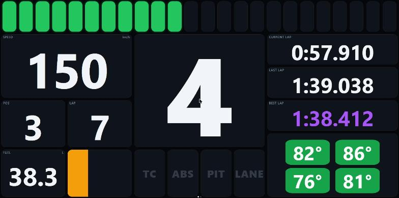
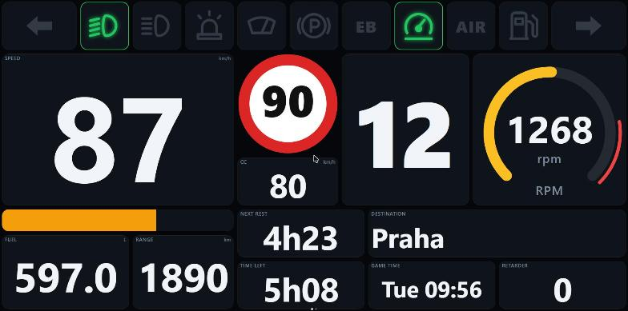
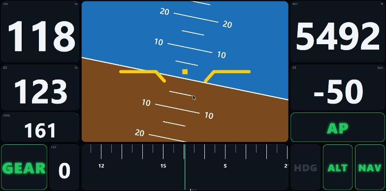
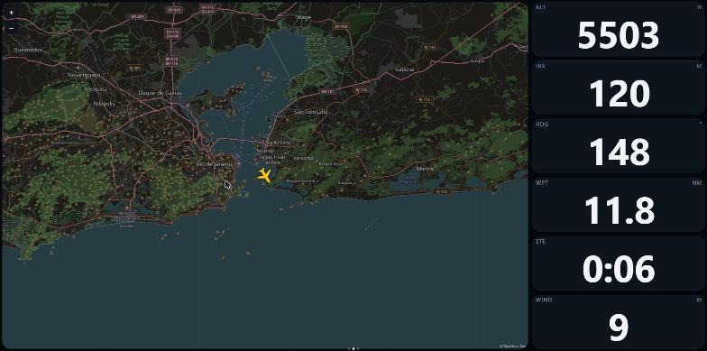
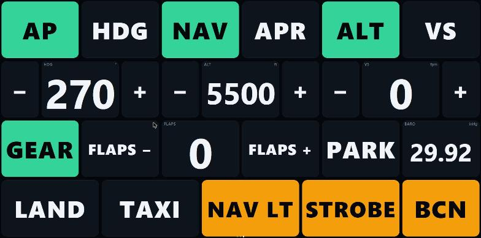
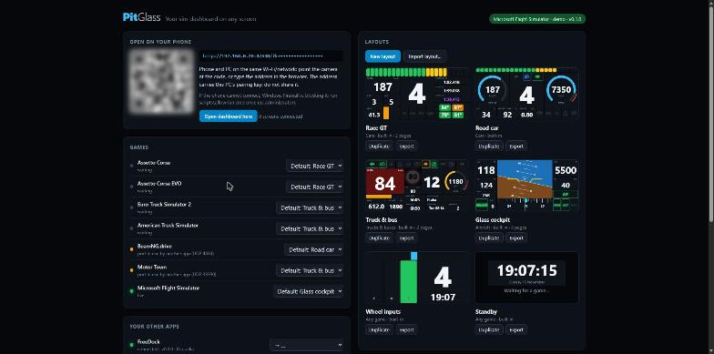
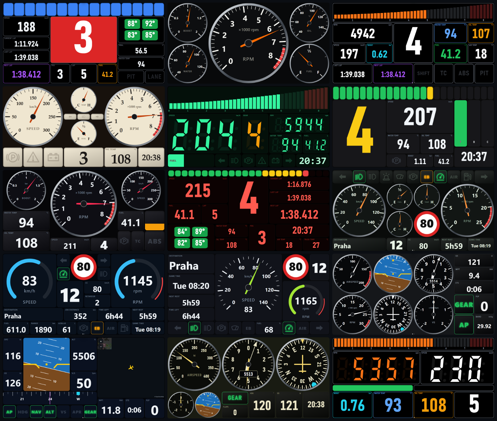
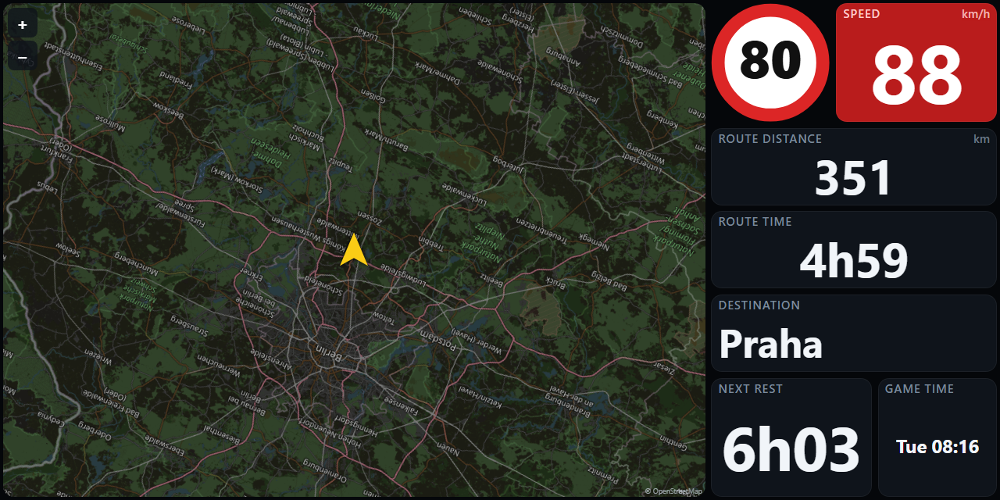
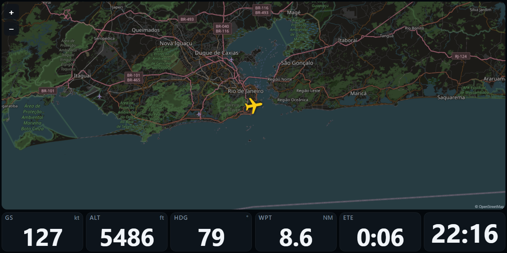
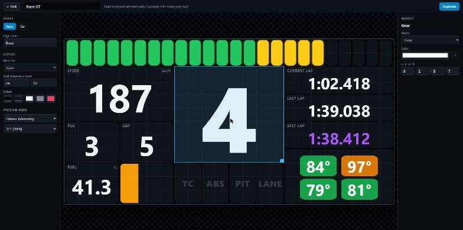

# PitGlass

**Transforme qualquer celular ou tablet num painel ao vivo do seu simulador.** O PitGlass roda no PC de jogos, lê a telemetria do jogo aberto e serve uma página de painel para qualquer tela da sua rede local. Coloque um celular antigo em cima do volante ou ao lado do manche: marcha, luzes de troca, tempos de volta, entrega do caminhão, horizonte artificial, mapa móvel.

Sem app para instalar no celular, sem conta, sem nuvem. É uma página web hospedada pelo seu próprio PC.

🇺🇸 [Read in English](README.md)



| Caminhões e ônibus | Glass cockpit |
| --- | --- |
|  |  |
| **Mapa móvel** | **Piloto automático (toque)** |
|  |  |

## O que ele faz

- **Um painel, vários jogos.** O layout troca sozinho quando você abre outro jogo.
- **Totalmente customizável.** Editor visual no navegador: arraste widgets numa grade, redimensione, escolha o que cada um mostra, mude as cores, crie páginas. Layouts são arquivos JSON que você pode compartilhar.
- **20 widgets**: números, displays de segmentos, marcha, luzes de troca, conta-giros em barra, barras, mostradores e relógios analógicos, luzes indicadoras, texto, relógio, temperatura dos pneus, placa de limite de velocidade, horizonte artificial, altímetro, giro direcional e fita de proa, mapa móvel, mapa da pista e botões de toque.
- **Mapas numa segunda tela.** Coloque um tablet ao lado do celular: a pista com a sua posição no Assetto Corsa, um GPS para o caminhão no ETS2/ATS, um mapa móvel para o avião no Flight Simulator.
- **Botões de toque** que agem no simulador (piloto automático, luzes, trem e flaps no Flight Simulator) e nos apps parceiros.
- **Português do Brasil e inglês**, unidades métricas ou imperiais.
- **Feito para celular antigo**: a página é pequena, não usa framework e só redesenha o que mudou.
- **Modo demonstração**: telemetria falsa de carro de corrida, caminhão ou avião, para montar layouts sem abrir um jogo.

## Jogos

| Jogo | Como o PitGlass lê | O que você precisa fazer |
| --- | --- | --- |
| Assetto Corsa | memória compartilhada do jogo | nada |
| Assetto Corsa EVO | memória compartilhada do jogo (voltas e posição ainda não são publicadas pelo jogo) | nada |
| Euro Truck Simulator 2 / American Truck Simulator | memória compartilhada do [scs-sdk-plugin](https://github.com/RenCloud/scs-sdk-plugin) | copiar `scs-telemetry.dll` para `<jogo>\bin\win_x64\plugins` |
| BeamNG.drive | OutGauge, UDP 4444 (dividida com o FreeDock) | Opções › Outros › Protocolos › ativar OutGauge, 127.0.0.1, porta 4444 |
| Motor Town: Behind the Wheel | saída de telemetria do jogo, UDP 33330 | Opções › Jogabilidade › Telemetry Data Output, 127.0.0.1:33330 |
| Microsoft Flight Simulator 2020 / 2024 | SimConnect | ter um `SimConnect.dll` no PC (SDK do MSFS, ou o plugin dos painéis Logitech, que traz um) |

> **Situação: 0.2, início.** Usado de verdade com Assetto Corsa e Euro Truck Simulator 2. Os outros leitores de jogo são portes de decodificadores que já rodam em hardware real no [FreeDock](https://github.com/agentkyo/freedock) e têm testes automatizados, mas ainda não foram usados dentro do PitGlass; o mesmo vale para os mapas que entraram na 0.2. Se algum valor parecer errado no seu jogo, abra uma issue.

## Começando (Windows)

Você precisa do [Node.js 24 ou mais novo](https://nodejs.org).

```
git clone https://github.com/agentkyo/pitglass
cd pitglass
PitGlass.cmd
```

O `PitGlass.cmd` instala as dependências na primeira vez, compila a página e o `PitGlass.exe`, e o inicia. O PitGlass passa a ficar na **bandeja do sistema** (os ícones ao lado do relógio) e abre o painel de controle em `http://localhost:47830`. Clique com o botão direito no ícone para abrir o painel de controle, reiniciar, **iniciar com o Windows**, criar um atalho na área de trabalho ou sair. Depois disso, abra pelo Menu Iniciar ou com dois cliques no `PitGlass.exe`.

O `PitGlass.exe` é um pequeno lançador compilado no seu PC a partir de [`tray/PitGlassTray.cs`](tray/PitGlassTray.cs), com o compilador de C# que já vem no Windows. Para rodar numa janela de console, use `PitGlass.cmd console`.



**No celular**: conecte na mesma rede/Wi-Fi do PC e leia o QR code que aparece no painel de controle.

Se o celular não conectar, o Firewall do Windows está bloqueando a porta. Rode `scripts\allow-lan.cmd` uma vez: ele pede permissão de administrador e libera a porta TCP 47830 **só para a sua rede local**.

Sem o atalho:

```
npm install
npm start            # compila e roda
npm run demo         # compila e roda com um carro de corrida falso
```

### Dicas para o celular

- Toque no painel para mostrar a barra: tela cheia e escolha de layout.
- Deslize para os lados para trocar de página.
- **Manter a tela ligada.** Os navegadores só deixam uma página segurar a tela acesa em `https` ou `localhost`. Duas saídas: ligar *Opções do desenvolvedor › Permanecer ativo* (a tela fica ligada enquanto carrega), ou usar o USB (abaixo).
- **USB em vez de Wi-Fi (Android):** ative a depuração USB, rode `adb reverse tcp:47830 tcp:47830` no PC e abra `http://localhost:47830/#/dash` no celular. Menos atraso, sem depender do Wi-Fi, e a página consegue manter a tela ligada sozinha.
- Adicione a página à tela inicial para abrir como um app.

## Layouts

O PitGlass vem com vinte e três layouts. Escolha um por jogo no painel de controle, ou pela barra no celular.



| Para | Layouts |
| --- | --- |
| Carros | **Race GT** · **Road car** · **Formula** (display de volante com LEDs de troca) · **Turbo-era formula** (um conta-giros grande e quatro mostradores pequenos) · **Pro datalogger** (painel de injeção programável, com página de largada) · **Classic '60s** (mostradores creme, aros cromados) · **Digital '84** (displays de segmentos) · **Rally** · **Street tuner** · **Night stint** (vermelho no preto) |
| Caminhões e ônibus | **Truck & bus** · **Classic truck** (analógico) · **Digital cluster** · **Coach** |
| Aviões | **Glass cockpit** · **Steam gauges** (o "six-pack") · **Airliner** (tela de voo ao lado do mapa) · **Warbird** |
| Mapas, para uma segunda tela | **Track map** (a pista e onde você está nela) · **Truck GPS** (o caminhão no mapa real, girando com a estrada, com distância e tempo da rota) · **Moving map** (o avião no mapa real) |
| Qualquer jogo | **Wheel inputs** · **Standby** |

| GPS do caminhão (ETS2 / ATS) | Mapa móvel (Flight Simulator) |
| --- | --- |
|  |  |

Cada tela guarda a própria escolha: leia o QR code também no tablet, toque na tela e escolha um mapa ali, enquanto o celular continua no painel. Mais em [docs/LAYOUTS.md](docs/LAYOUTS.md#maps-and-a-second-screen) (em inglês).

Abra o painel de controle, escolha um layout e clique em **Duplicar**: os de fábrica são somente leitura, e a cópia é sua para mudar.



- Os layouts ficam em `%APPDATA%\PitGlass\layouts` como JSON. **Exportar** e **Importar** estão no painel de controle.
- O formato, todos os widgets e todos os canais estão em [docs/LAYOUTS.md](docs/LAYOUTS.md) (em inglês).
- Fez um bom? Mande para a pasta [`layouts/`](layouts) com um pull request.

## Funciona com

O PitGlass conversa com estes apps parceiros quando eles estão abertos. Tudo opcional.

| App | O que o PitGlass faz com ele |
| --- | --- |
| [FreeDock](https://github.com/agentkyo/freedock) (stream deck MiraBox N4) | mostra a página atual do deck; botões do painel podem trocar a página do deck |
| [Ambibox LED](https://github.com/agentkyo/ambibox-led-ambilight) (fita ambilight USB) | pisca a fita em roxo a cada nova melhor volta; botões do painel podem piscar a fita ou ligar os efeitos de jogo |
| IAmPcGamer | mostra o jogo detectado; botões do painel podem capturar a tela ou alternar o overlay |
| MyWheel | mostra o volante conectado; aceita o sinal ao vivo de direção/pedais/marcha, então os widgets de entrada funcionam até em jogos sem telemetria |

Ele também tem uma pequena API local para as suas ferramentas: `GET /api/telemetry` devolve os valores atuais em JSON, e `ws://localhost:47830/ws` transmite ao vivo. Veja [docs/INTEGRATIONS.md](docs/INTEGRATIONS.md) (em inglês).

## Privacidade e segurança

- Nada sai da sua rede. O único pedido externo é o mapa móvel, que carrega as imagens do OpenStreetMap no celular.
- O servidor escuta na sua rede local. Uma tela fora do PC precisa apresentar a **chave de pareamento** que vai no QR code; sem ela, todo pedido é recusado. Trate o endereço como uma senha.
- Pedidos vindos de outros sites são recusados (Host e Origin são conferidos), então uma página aberta no seu navegador não consegue controlar o PitGlass.
- Um celular pareado pode ver os painéis e apertar os botões do painel. Editar layouts e configurações só é possível no próprio PC.
- Os botões do painel só disparam ações de uma lista fixa (um conjunto de eventos do Flight Simulator e as ações dos apps parceiros acima). Não existe "rodar comando" nem "apertar tecla".

## Planos

- Instalador para Windows que não precise do Node.js.
- Outros carros no mapa da pista.
- Mais jogos: Assetto Corsa Competizione, iRacing, rFactor 2 / Le Mans Ultimate, Forza (data out), X-Plane, DCS.
- Delta para a melhor volta, calculadora de combustível por volta.
- Suporte a Linux para os jogos UDP.

## Desenvolvimento

```
npm run typecheck
npm test
npm run build
```

O servidor é TypeScript executado direto pelo Node (sem etapa de build). A página em `web/` é empacotada com esbuild em `dist/web`. Para adicionar um jogo, escreva um `Source` em `src/server/sources` que devolva um quadro de [canais](src/shared/channels.ts); todos os layouts passam a funcionar com ele.

## Licença

[MIT](LICENSE). Dados do mapa © contribuidores do [OpenStreetMap](https://www.openstreetmap.org/copyright).

O PitGlass não tem vínculo com nenhuma produtora de jogos. Os nomes dos jogos são marcas de seus donos.
